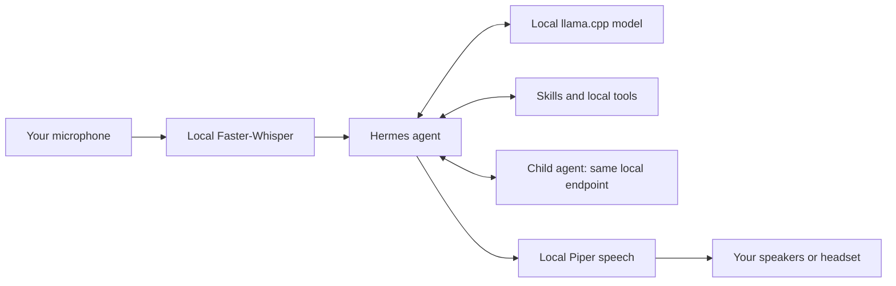

# Hermes Local Voice Guide

**Talk to a local Hermes agent, hear its replies, and give it a practical workflow for skills and child agents.**

This repository explains a working native **Windows x64** setup from installation to verification. It includes a manual walkthrough, reusable setup scripts, two skills, microphone diagnostics, and rollback instructions. You do not need the original author's folders, credentials, or recordings.

The tested stack is **Hermes → llama.cpp → Agents-A1-4B**, with **Faster-Whisper** listening on CPU and **Piper** speaking on CPU. The local LLM uses a GPU when available. Once the required models are downloaded, these three inference engines do not need a paid API or a cloud inference service. Skill search and web tasks still use the internet.

> This is an independent community guide, not an official Hermes distribution. It adds configuration and procedures; it does not turn a small model into a frontier model. Verify important results.

## What you will build



| Component | Choice in the verified build | Why |
| --- | --- | --- |
| Agent | Hermes 0.22.5 | Native tools, skills, delegation, and voice |
| LLM server | llama.cpp, Vulkan build | Works with the tested AMD GPU |
| Model | Agents-A1-4B, official Q8_0 GGUF | Agent-focused model below a 6B parameter budget |
| Context | 65,536 tokens, one server slot | Meets this Hermes version's 64K floor |
| Listening | Faster-Whisper `base`, CPU int8 | No speech API key; leaves GPU memory for the LLM |
| Speaking | Piper `en_US-lessac-medium`, CPU | Local speech synthesis |
| Workers | One child at a time, 40 tool turns | Practical resource limits for one local GPU |

The original reference machine had an AMD Radeon RX 5700 with 8 GB VRAM. That is a tested example, not a universal hardware requirement or performance promise. CPU-only use is possible but can be much slower. See [platforms and requirements](docs/platforms.md).

## Start here

Follow the numbered guide if you are new to local agents:

1. [Install Hermes, llama.cpp, and a model](docs/01-install.md)
2. [Configure and use listening and speech](docs/02-voice.md)
3. [Add skill discovery and child-agent workflows](docs/03-skills-and-agents.md)
4. [Troubleshoot the problems we encountered](docs/04-troubleshooting.md)
5. [Understand how and why this setup was built](docs/05-how-it-was-built.md)
6. [Validate the whole system and roll back](docs/06-validation-and-rollback.md)

Already have a working Hermes source installation? The short path below is for you.

## Short setup: native Windows source install

Use a normal PowerShell window, not an administrator shell. Install Git if you want to clone; otherwise use GitHub's **Code → Download ZIP**, extract it, and open PowerShell in the extracted folder.

```powershell
git clone https://github.com/owaise-collab/hermes-local-voice-guide.git
cd hermes-local-voice-guide

# Confirm Hermes works before changing its setup.
hermes --version

# Preview the changes; this does not install dependencies or write user files.
.\scripts\Configure-Hermes.ps1 -DryRun

# Install supported speech extras through Hermes PM, back up config, and configure.
.\scripts\Configure-Hermes.ps1
```

The default Hermes home is `$env:HERMES_HOME`, or `%LOCALAPPDATA%\hermes` when unset. The scripts expect a native Windows source installation with `hermes-agent` below that home. For another layout, pass `-HermesHome` and `-HermesSource`. Signed Desktop bundles should use the [manual settings path](docs/02-voice.md#manual-configuration) rather than these source-runtime helpers.

Get a supported llama.cpp binary from its [official releases](https://github.com/ggml-org/llama.cpp/releases), extract the full build to `C:\AI\llama.cpp`, and verify `llama-server.exe --list-devices`. The full installation guide explains which backend to choose.

Download the verified model, or use your own suitable GGUF:

```powershell
$HermesData = if ($env:HERMES_HOME) { $env:HERMES_HOME } else { Join-Path $env:LOCALAPPDATA 'hermes' }
$ModelFile = Join-Path $HermesData 'models\Agents-A1-4B-Q8_0.gguf'
.\scripts\Invoke-HermesPython.ps1 -Script .\scripts\download-model.py -ScriptArgs @('--output', $ModelFile)

.\scripts\Start-Hermes.ps1 -LlamaServer 'C:\AI\llama.cpp\llama-server.exe' -ModelPath $ModelFile
```

Inside Hermes:

```text
/voice on
```

Press **Ctrl+B**, speak, and pause for about two seconds. Hermes transcribes the recording locally and speaks its reply. Say **stop** to end the voice loop. Voice mode starts through this explicit command; the setup script does not silently turn the microphone on at login.

## Verify before relying on it

```powershell
# List input/output devices without recording.
.\scripts\Invoke-HermesPython.ps1 -Script .\scripts\check-audio.py

# Test synthetic speech -> transcription; explicitly opt into a brief mic check and playback.
$VoiceChecks = Join-Path $HermesData 'runtime\voice-guide-checks'
.\scripts\Invoke-HermesPython.ps1 -Script .\scripts\verify-voice.py -ScriptArgs @('--output-dir', $VoiceChecks, '--capture-microphone', '--play')
```

For a real listening test, use `/voice on` and Ctrl+B, or the optional [live test script](docs/06-validation-and-rollback.md). Then test a real child agent and inspect its file. The full validation guide separates model health, tool calling, microphone capture, transcription, speech generation, and audible playback.

## What the configuration changes

- Points the main model and child agents to `http://127.0.0.1:8080/v1` using alias `local-hermes`.
- Sets the context to 65,536 and disables model fallback chains in the configured routes.
- Uses local Whisper and Piper, enables spoken replies when `/voice on` is selected, and sets a two-second silence timeout.
- Adds adapted `find-skills` and `local-agent-team` skills plus an appended SOUL workflow.
- Preserves unrelated settings and existing SOUL text, with backups under the Hermes home.

Review [the configuration fragment](config/hermes-local.example.yaml), [SOUL addition](config/soul-addition.md), and scripts before applying them. You can use the manual path without running the configurator.

## Scope and reproducibility

The original Windows setup passed skill retrieval, public catalog search, real child-agent execution and parent verification, microphone capture, local live transcription, Piper generation, and speaker playback. The public kit also includes configuration regression tests. These results establish the tested paths, not every possible machine, model, accent, or agent task. See [the validation record](docs/06-validation-and-rollback.md#reference-validation-record).

There are no model weights, credentials, original user configuration, session databases, personal memories, microphone recordings, or raw application logs in this repository. Generated test files stay outside the repository by default.

## License and upstream projects

The guide and original helper code are [MIT licensed](LICENSE). Third-party code, models, and voices retain their own licenses. The adapted Vercel skill retains its attribution and license notice in [THIRD_PARTY_NOTICES.md](THIRD_PARTY_NOTICES.md).

Primary references: [Hermes installation](https://hermes-agent.nousresearch.com/docs/getting-started/installation), [voice mode](https://hermes-agent.nousresearch.com/docs/user-guide/features/voice-mode), [TTS](https://hermes-agent.nousresearch.com/docs/user-guide/features/tts), [skills](https://hermes-agent.nousresearch.com/docs/user-guide/features/skills), [delegation](https://hermes-agent.nousresearch.com/docs/user-guide/features/delegation), [llama.cpp](https://github.com/ggml-org/llama.cpp), and [the chosen model](https://huggingface.co/InternScience/Agents-A1-4B).
